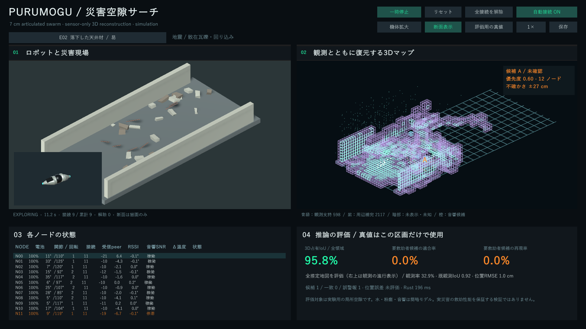
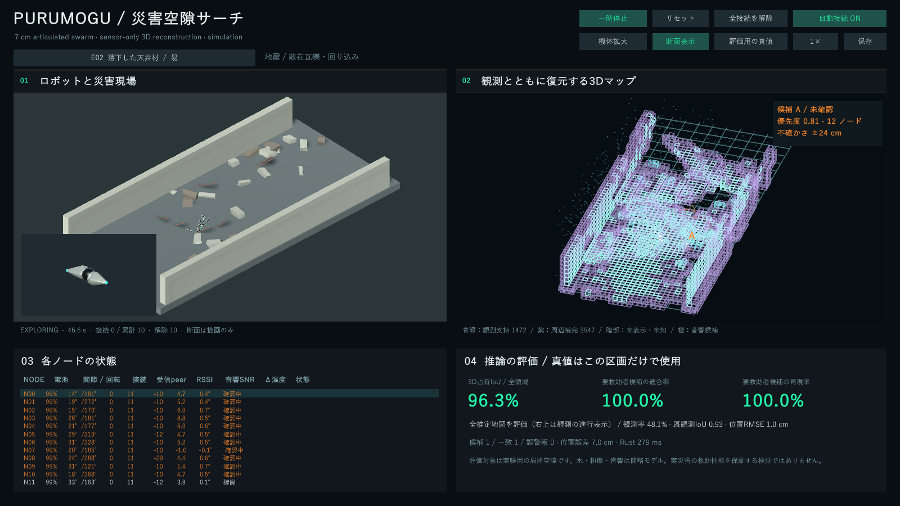

# ぷるもぐサーチ

[提出用レポート（PDF・2026年10月29日）](output/pdf/Purumogu_Search_Report_20261029.pdf)は、距離・音響の補正、地図と候補履歴の学習、v9からv13への改善と到達精度を9ページにまとめています。VALIDとモデル固定後のTEST、旧12台条件と現行24・36・48台条件を分けて記載しています。[本文の編集用テキスト](output/pdf/Purumogu_Search_Report_20261029.md)もあります。

現行3.1は、両画面のドラッグ回転・ホイールズーム、操作バーの刷新、中央球を含む6接続面、観測から成長する点群、ガス・浸水の模擬反応表示に対応する。人候補は黄橙、ガスは赤紫、浸水は青とし、形とラベルを併用する。[操作・接続・危険表示の説明](docs/rescue-interface-v31.md)と[使用済みナレーション原稿](media/ナレーション原稿_災害シミュレーション_使用版.txt)を参照。変更後の95%到達は未確認。

災害後の局所空隙を、全長約7cmの関節ノード24・36・48台で調べるUnity × Rustシミュレーターです。中央球と二つの扁平な円錐が曲がり、長軸回りに回転し、仲間と接続・解除します。地震・斜面崩壊・浸水を、易・中・難の各5シーンで扱います。

**最初の最終TESTでは再現率が不足し、95%の合格条件は未達です。** モデルv13はVALID 30変種で全領域3D IoU平均95.67%・合算95.65%、適合率・再現率96.88%でしたが、固定後のTEST 45変種ではIoU平均95.05%・合算95.12%、適合率97.73%、再現率89.58%（43/48人、誤警報1）となりました。観測予算は1変種あたり360秒、12台です。失敗結果を残し、同じTRAINで候補判別器を改善し、VALIDを90変種に増やしています。分類器のスキャン正解率を、救助者の検出精度には置き換えません。

旧条件の追加学習はTRAIN450まで実施しました。音響候補へ近づいて観測する探索を加えた12台のVALID90では、91/96人を検出し、誤警報5、適合率・再現率は各94.79%でした。95%の合格条件は未達です。現在は追加指定に従い、24・36・48台を現場全域へ分散投下する条件へ拡張しています。旧12台・入口整列の結果とは分けて学習・評価し直し、未使用確認データはまだ開いていません。

## 動かす

ソースから動かす場合は、Windows x64、PowerShell **7**、Unity **6000.4.1f1**、Rust **1.94.1**を使います。Unityはビルドする利用者の有効なライセンスが必要です。Rustの依存関係はCargo.lockで固定しています。

```powershell
cargo test --manifest-path rust/Cargo.toml --workspace --locked
./scripts/Unity-Task.ps1 build
./scripts/Start-Demo.ps1 -Nodes 24
```

初回のビルドはUnity Package ManagerとCargoの依存取得にネットワークを使います。推論はCPU上の独立したRustプロセスで行い、127.0.0.1のTCP/JSON LinesでUnityと接続します。

画面は、左上が物理現場と選択機体、右上が推定3Dマップと未確認候補、左下がノード状態、右下が真値との評価です。青緑は距離観測、紫は学習補完、黄橙は人候補、赤紫はガス反応、青は浸水です。左上と右上のそれぞれで、左ドラッグまたはホイール押し込みドラッグで回転し、ホイール回転で拡大・縮小できます。各画面の「戻す」で角度と倍率を初期化します。感度は基準画面1pxあたり0.16度、各軸の回転速度上限は60度/秒で、上下反転を防ぎます。一時停止中も操作できます。

ノード数はリセット後に24・36・48台を切り替え、「配置を変える」で配置だけを変えられます。配置はモデル化した現場全域に広がり、12秒かけて順に投下します。落下先は重力と衝突で決まり、床面へ移し替えません。「透視」では、床板を半透明と輪郭で表示します。衝突する床板の描画を消すことはありません。瓦礫は易64・中104・難144片に梁片6・11・16本を加え、実際の衝突・センサー遮蔽にも反映します。新条件の精度は検証中です。

右上は繰り返し観測の支持が増えた部分から表示します。細密レイヤーは距離観測の端点を1cm格子で集約し、最大3mmの平滑化とソフトな点描画を使います。観測済み5cmセルの輪郭を薄く重ねます。1cmは表示の集約間隔で、推定精度ではありません。評価セルは5cmを保ちます。未観測の形状事前分布を、最初から全域へ描きません。以下は旧12台・入口整列条件の同じデモ実行の11秒と47秒で、集計結果を代表する試行ではありません。





## 今日から試す3例

1. **E02で機構を見る**：`./scripts/Start-Demo.ps1 -Scene 1`。ノードを拡大し、球体に対する屈曲・回転と「全接続を解除」を確認します。
2. **M02で複数音源を見る**：`./scripts/Start-Demo.ps1 -Scene 6`。候補数と一致数を比較し、橙の表示を確認済みの人と解釈しないでください。
3. **E05で負例を見る**：`./scripts/Start-Demo.ps1 -Scene 4`。人以外の機械音に対する誤警報を、右下で確認します。

## 検証と学習

```powershell
./scripts/Unity-Task.ps1 rescue-smoke
python tests/test_rescue_contract.py
python scripts/evaluate_rescue_replay.py --model models/rescue-v13/model.json --output reports/rescue/replay.json
```

再生には収集済みの生ログが必要です。物理試験は15シーンの接続・解除・屈曲・回転・移動、重力落下の喪失処理を確認します。25mm垂直段差は**乗り越え不通過、迂回通過**でした。機構試験の合格を段差走破の保証として扱いません。

- TRAIN 150変種：seed `20400000 + 997*r`、r=0..9。
- VALID 30変種：seed `20500000 + 997*r`、r=0..1。係数の学習には使わず、設定の選択に使います。
- 最初のTEST 45変種：seed `20600000 + 997*r`、r=0..2。v13固定後に開封し、再現率不足となりました。係数学習・閾値調整には使いません。
- 追加VALID 60変種：seed `20501994 + 997*r`、r=0..3。元の30変種と合わせて90変種で選択します。
- 中央球接続・環境観測を加えた現行条件は、[3.1事前登録](reports/rescue/swarm-v31/protocol-design.json)でTRAIN225試行・VALID90試行・未使用TEST135試行へ分けています。TESTはseed `20700000 + 997*r`、r=0..2の45現場×3台数です。旧3.0の途中収集は合格実績に含めません。同じ現場の24・36・48台を別の分割に混ぜず、各台数と全体の両方で95%を判定します。

地図は5cmセル、評価領域全体の占有IoUを使います。未観測の真の障害物も分母に含めます。検出は25cm以内の一対一対応で、適合率と再現率を別々に測ります。合格には3指標がすべて95%以上必要です。人の口元・熱の点は変種ごとに独立に配置し、人の座標、人数、ラベル、シーンID、地形は推論サーバーへ送りません。詳細は[設計・条件・失敗例](docs/rescue-v2.md)と[データ生成記録](reports/rescue/generation-2.5.json)を参照してください。

音響分類・距離回帰・占有補正・形状事前分布はTRAINから学習します。候補履歴の判別器はRustのIRLSで学習し、継続時間、位置のばらつき、独立ノード数、音響・温度・距離残差を使います。候補の絶対位置は分類特徴に入れません。Pythonはデータ整形、初段の数値学習、評価・モデル選択を担います。v13の記録は[学習条件](models/rescue-v13/training-report.json)と[実RustでのVALID再生](reports/rescue/mission360/learning-v13-valid.json)にあります。

データ収集からモデル選択までの手順は[学習・再現手順](docs/reproduce-rescue-v2.md)に記載しています。最終TESTを開く前に、モデル・実行バイナリ・物理ソース・時間予算を[評価固定記録](reports/rescue/mission360/protocol-lock.json)へ保存します。

## できることと弱点

**利点**：物理動作、センサー誤差、推論、真値評価を一つの画面で比較でき、観測と学習による補完を区別できます。ログだけでRustの推論を再生できます。TCPは重複・順序・異常値・真値フィールドを検証します。

**欠点**：接地推進は理想化した接線力です。音響反射・熱・水・粉塵も簡略モデルで、要救助者の全身の占有体積は扱いません。15形状族を超える倒壊形態、実機センサー、実災害での性能は未検証です。優先すべき改善は、複数視点の観測を集める探索、低発声と雑音の分離、実測による校正です。

別の方法として、実測データと小規模実機試験を追加する方が、同じ生成器上で学習回数だけを増やすより実災害への妥当性を検証しやすくなります。本プロジェクトの数値は実災害の救助率を示しません。[NISTの応答ロボット試験](https://www.nist.gov/el/intelligent-systems-division-73500/standard-test-methods-response-robots)も、移動・センサー・通信などの能力を分けて測る枠組みを提供しています。本実装がその標準へ適合したという意味ではありません。

## 原設計と成果物

原設計のイベントグラフ推定、情報獲得型の投入ゲート制御、固定・ランダム・GHOST-FLOWの比較はPhase 1として保持しています。[Phase 1の手順と実測結果](docs/phase1-readme.md)を参照してください。v2では追加指定に従い、機体形状、15災害シーン、模擬センサー、3D地図と人候補の4分割画面を拡張しました。

動画のナレーションは音読さん、音楽はSuno AI、編集・ミックス・最終出力はDaVinci Resolveを使用します。媒体の利用条件は[クレジット](media/CREDITS.md)を参照してください。コードはMITライセンスです。音声・音楽はMITで再許諾していません。
