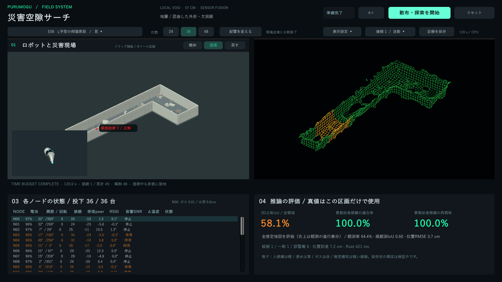
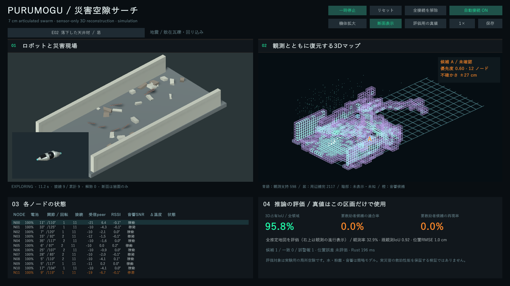
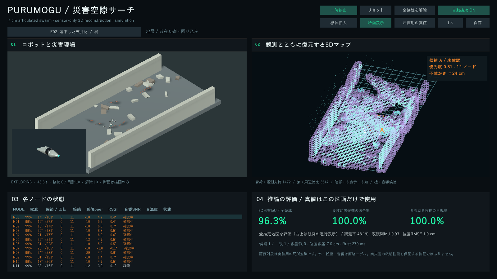

# ぷるもぐサーチ

**ウィンドウ対応版3.5.1（2026年11月2日）**：[ダウンロード](https://github.com/Applekeynote/purumogu-search/releases/tag/v0.3.5.1)。枠のドラッグでサイズを変更でき、最大化・元に戻す操作に対応します。初期サイズは最大1280×720で、以前のフルスクリーン設定も起動時に解除します。学習済みモデルと36シーンは3.5と同じです。

**現時点完成版3.5（2026年11月1日）**：[WindowsアプリとUnityプロジェクトをダウンロード](https://github.com/Applekeynote/purumogu-search/releases/tag/v0.3.5)。Windows版はZIP全体を展開し、`PurumoguSearch.exe`を起動します。Unity・Rust・Pythonの追加導入は不要です。36シーンと学習済みCPU推論を同梱しています。

部分崩落を層構造で表すC01〜C06を追加しました。残存床、欠損、落下床片、層状瓦礫を衝突・遮蔽にも使い、層間隔・人物位置も変えます。利用者の指定により、完成した機能と検証済みのR36モデルで作業を完了しました。追加学習と途中の長時間検証は停止し、途中モデルは採用していません。[完成範囲・到達精度・使い方](docs/v35-completion.md)、[部分崩落の条件](docs/rescue-layered-collapse.md)、[学習記録](docs/rescue-generic-learning.md)を参照してください。**全エリアで地図IoU・人物の適合率・再現率がすべて95%以上という合格を確認した版ではありません。**

Unity Hubを使う場合は、同じリリースの `PurumoguSearch-Unity-v3.5.zip` を展開し、`PurumoguSearch-Unity-v3.5` フォルダーをプロジェクトとして追加します。Unity 6000.4.1f1で `Assets/Scenes/Main.unity` を開き、再生します。このZIPには推論実行物も含めています。

以下は旧版3.4の記録です。

[Windows配布版3.4をダウンロード](https://github.com/Applekeynote/purumogu-search/releases/tag/v0.3.4)。ZIPをすべて展開し、`PurumoguSearch.exe`を開くと同梱の推論が起動します。周辺観測から欠測を補完し、推定部分は暗い破線、人候補は橙、浸水は青、ガスは赤の格子で表示します。L/T/Y/U字・中庭・二層・三層など15エリアを追加し、全30シーンにしました。[推論方式・実行結果・制限](docs/complex-mapping-v34.md)を確認してください。新形状を含む95%条件は未達成の開発版です。



[提出用レポート（PDF・2026年10月29日）](output/pdf/Purumogu_Search_Report_20261029.pdf)は、距離・音響の補正、地図と候補履歴の学習、v9からv13への改善と到達精度を9ページにまとめています。VALIDとモデル固定後のTEST、旧12台条件と現行24・36・48台条件を分けて記載しています。[本文の編集用テキスト](output/pdf/Purumogu_Search_Report_20261029.md)もあります。

旧3.1は、両画面のドラッグ回転・ホイールズーム、操作バーの刷新、中央球を含む6接続面、観測から成長する点群、ガス・浸水の模擬反応表示に対応する。人候補は黄橙、ガスは赤紫、浸水は青とし、形とラベルを併用する。[操作・接続・危険表示の説明](docs/rescue-interface-v31.md)と[使用済みナレーション原稿](media/ナレーション原稿_災害シミュレーション_使用版.txt)を参照。変更後の95%到達は未確認。

災害後の局所空隙を、全長約7cmの関節ノード24・36・48台で調べるUnity × Rustシミュレーターです。中央球と二つの扁平な円錐が曲がり、長軸回りに回転し、仲間と接続・解除します。地震・斜面崩壊・浸水を扱い、開発ソースには従来30シーンに部分崩落6シーンを追加しています。

**最初の最終TESTでは再現率が不足し、95%の合格条件は未達です。** モデルv13はVALID 30変種で全領域3D IoU平均95.67%・合算95.65%、適合率・再現率96.88%でしたが、固定後のTEST 45変種ではIoU平均95.05%・合算95.12%、適合率97.73%、再現率89.58%（43/48人、誤警報1）となりました。観測予算は1変種あたり360秒、12台です。失敗結果を残し、同じTRAINで候補判別器を改善し、VALIDを90変種に増やしています。分類器のスキャン正解率を、救助者の検出精度には置き換えません。

旧条件の追加学習はTRAIN450まで実施しました。音響候補へ近づいて観測する探索を加えた12台のVALID90では、91/96人を検出し、誤警報5、適合率・再現率は各94.79%でした。95%の合格条件は未達です。現在は追加指定に従い、24・36・48台を現場全域へ分散投下する条件へ拡張しています。旧12台・入口整列の結果とは分けて学習・評価し直し、未使用確認データはまだ開いていません。

## 動かす

ソースから動かす場合は、Windows x64、PowerShell **7**、Unity **6000.4.1f1**、Rust **1.94.1**を使います。Unityはビルドする利用者の有効なライセンスが必要です。Rustの依存関係はCargo.lockで固定しています。

```powershell
cargo test --manifest-path rust/Cargo.toml --workspace --locked
./scripts/Unity-Task.ps1 build
./scripts/Start-Demo.ps1 -Nodes 24
```

初回のビルドはUnity Package ManagerとCargoの依存取得にネットワークを使います。推論はCPU上の独立したRustプロセスで行い、127.0.0.1のTCP/JSON LinesでUnityと接続します。

画面は、左上が物理現場と選択機体、右上が緑の線で空間の輪郭を表す反響マップ、左下がノード状態、右下が真値との評価です。人候補は橙、ガス反応は赤、浸水反応は青に格子の色が変わります。推定補完は暗い破線で実観測と区別します。右上に判断欄・凡例・断面・点群は表示しません。左上と右上のそれぞれで、左ドラッグまたはホイール押し込みドラッグで回転し、ホイール回転で拡大・縮小できます。各画面の「戻す」で角度と倍率を初期化します。感度は基準画面1pxあたり0.16度、各軸の回転速度上限は60度/秒で、上下反転を防ぎます。一時停止中も操作できます。

ノード数はリセット後に24・36・48台を切り替え、「配置を変える」でノードと人物の位置を変えられます。開発ソースではシーン選択内の「地形も変える」で、床の欠損・層間隔・瓦礫も変更できます。標準では上空と複数の破損開口から分散投入し、「投入」で上空のみへ切り替えられます。落下先は重力と衝突で決まり、床面へ移し替えません。「透視」では、床板を半透明と輪郭で表示します。衝突する床板の描画を消すことはありません。瓦礫は実際の衝突・センサー遮蔽にも反映します。新条件の精度は検証中です。

右上は繰り返し観測の支持が増えた部分から線が現れます。観測に基づく輪郭と、周辺観測から補完した輪郭を区別し、未観測の全形状を最初から描きません。表示を滑らかにしても、評価セルは5cmを保ちます。以下の2枚は以前の点群表示・旧12台・入口整列条件で撮影した履歴です。現在の表示や集計成績を代表する試行ではありません。





## 今日から試す3例

1. **E02で機構を見る**：`./scripts/Start-Demo.ps1 -Scene 1`。ノードを拡大し、球体に対する屈曲・回転と「全接続を解除」を確認します。
2. **M02で複数音源を見る**：`./scripts/Start-Demo.ps1 -Scene 6`。候補数と一致数を比較し、橙の表示を確認済みの人と解釈しないでください。
3. **E05で負例を見る**：`./scripts/Start-Demo.ps1 -Scene 4`。人以外の機械音に対する誤警報を、右下で確認します。

## 検証と学習

ソースの回帰検査には、Python 3.12とCPU版PyTorchを使えます。下記は研究用の重みやセンサーデータを置かない環境でも実行できます。公開アプリを使うだけなら、PythonやPyTorchの導入は不要です。

```powershell
python -m pip install -c requirements-training.txt numpy scikit-learn scipy joblib threadpoolctl
python -m pip install torch==2.8.0 --index-url https://download.pytorch.org/whl/cpu
cargo build --manifest-path rust/Cargo.toml --workspace --release --locked
python scripts/check_rescue_learning.py
```

この検査はTCPの異常入力、学習・評価世界の分離、時間を打ち切った入力の一致、細分格子と補助正解の対応を含みます。Unityの物理検査と、推論精度の評価は別に行います。CUDAを使って学習する環境の依存関係は `scripts/requirements-volume.txt` に固定しています。

```powershell
./scripts/Unity-Task.ps1 rescue-smoke
python tests/test_rescue_contract.py
python scripts/evaluate_rescue_replay.py --model models/rescue-v13/model.json --output reports/rescue/replay.json
```

再生には収集済みの生ログが必要です。物理試験は15シーンの接続・解除・屈曲・回転・移動、重力落下の喪失処理を確認します。25mm垂直段差は**乗り越え不通過、迂回通過**でした。機構試験の合格を段差走破の保証として扱いません。

- TRAIN 150変種：seed `20400000 + 997*r`、r=0..9。
- VALID 30変種：seed `20500000 + 997*r`、r=0..1。係数の学習には使わず、設定の選択に使います。
- 最初のTEST 45変種：seed `20600000 + 997*r`、r=0..2。v13固定後に開封し、再現率不足となりました。係数学習・閾値調整には使いません。
- 追加VALID 60変種：seed `20501994 + 997*r`、r=0..3。元の30変種と合わせて90変種で選択します。
- 中央球接続・環境観測を加えた現行条件は、[3.1事前登録](reports/rescue/swarm-v31/protocol-design.json)でTRAIN225試行・VALID90試行・未使用TEST135試行へ分けています。TESTはseed `20700000 + 997*r`、r=0..2の45現場×3台数です。旧3.0の途中収集は合格実績に含めません。同じ現場の24・36・48台を別の分割に混ぜず、各台数と全体の両方で95%を判定します。

地図は5cmセル、評価領域全体の占有IoUを使います。未観測の真の障害物も分母に含めます。検出は25cm以内の一対一対応で、適合率と再現率を別々に測ります。合格には3指標がすべて95%以上必要です。人の口元・熱の点は変種ごとに独立に配置し、人の座標、人数、ラベル、シーンID、地形は推論サーバーへ送りません。詳細は[設計・条件・失敗例](docs/rescue-v2.md)と[データ生成記録](reports/rescue/generation-2.5.json)を参照してください。

音響分類・距離回帰・占有補正・形状事前分布はTRAINから学習します。候補履歴の判別器はRustのIRLSで学習し、継続時間、位置のばらつき、独立ノード数、音響・温度・距離残差を使います。候補の絶対位置は分類特徴に入れません。Pythonはデータ整形、初段の数値学習、評価・モデル選択を担います。v13の記録は[学習条件](models/rescue-v13/training-report.json)と[実RustでのVALID再生](reports/rescue/mission360/learning-v13-valid.json)にあります。

データ収集からモデル選択までの手順は[学習・再現手順](docs/reproduce-rescue-v2.md)に記載しています。最終TESTを開く前に、モデル・実行バイナリ・物理ソース・時間予算を[評価固定記録](reports/rescue/mission360/protocol-lock.json)へ保存します。

## できることと弱点

**利点**：物理動作、センサー誤差、推論、真値評価を一つの画面で比較でき、観測と学習による補完を区別できます。ログだけでRustの推論を再生できます。TCPは重複・順序・異常値・真値フィールドを検証します。

**欠点**：接地推進は理想化した接線力です。音響反射・熱・水・粉塵も簡略モデルで、要救助者の全身の占有体積は扱いません。15形状族を超える倒壊形態、実機センサー、実災害での性能は未検証です。優先すべき改善は、複数視点の観測を集める探索、低発声と雑音の分離、実測による校正です。

別の方法として、実測データと小規模実機試験を追加する方が、同じ生成器上で学習回数だけを増やすより実災害への妥当性を検証しやすくなります。本プロジェクトの数値は実災害の救助率を示しません。[NISTの応答ロボット試験](https://www.nist.gov/el/intelligent-systems-division-73500/standard-test-methods-response-robots)も、移動・センサー・通信などの能力を分けて測る枠組みを提供しています。本実装がその標準へ適合したという意味ではありません。

## 原設計と成果物

原設計のイベントグラフ推定、情報獲得型の投入ゲート制御、固定・ランダム・GHOST-FLOWの比較はPhase 1として保持しています。[Phase 1の手順と実測結果](docs/phase1-readme.md)を参照してください。v2では追加指定に従い、機体形状、15災害シーン、模擬センサー、3D地図と人候補の4分割画面を拡張しました。

動画のナレーションは音読さん、音楽はSuno AI、編集・ミックス・最終出力はDaVinci Resolveを使用します。媒体の利用条件は[クレジット](media/CREDITS.md)を参照してください。コードはMITライセンスです。音声・音楽はMITで再許諾していません。
