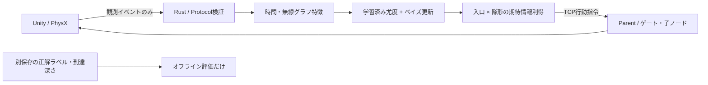

# 実装の境界と研究上の限界

Unityは、形状生成、50 Hzの剛体物理、ゲート、局所モーター制御、IMU・受信無線の模擬と表示を担当する。Rustはイベント検証、時間・無線グラフ集計、学習、ベイズ更新、期待情報利得による行動選択、評価を担当する。外部APIやGPU推論は不要。

## 学習と推論

TRAINだけで特徴の平均・標準偏差を求め、16個のコードブック中心を学習する。入口3個×隊形2個の各行動について、候補族別の観測符号の頻度に擬似カウント1を加える。VALIDのエピソード末尾のlog lossで温度を選び、TEST前に固定する。

事後更新はバッチ末尾に1回だけ行う。近接するセンサー窓を独立観測として掛け続けない。行動は、同じ5個の投入で得られる予測分布のエントロピー減少が最大になるものを選ぶ。3バッチで15個を使い、5個は予備とする。

履歴は既投入数で粗く表すにとどまる。同一エピソードで持続する摩擦や既存ノード配置を完全には条件付けていない。この近似のため、情報利得の大きさは実際の正解率の改善を保証しない。

## 物理と親子制御

ノードは中央Boxと4本の短いCapsuleアームからなる複合Colliderを持つ。質量24g。座標の連続書き換えではなく、重力・摩擦・衝突とAddForce/AddTorqueで動く。ゲートはkinematic Rigidbodyを動かして実際に支持面を外す。

CLUSTERは分散した局所移動、CHAIN_INSERTは姿勢整列と捕捉距離6.6cm以内・相対角45度以内でのFixedJoint連結を行う。1個あたり最大2接続。破断後0.5秒の待機時間を設ける。モーターの壁追従には5.5cmの局所接触予見を用いる。連結時の近接位置は模擬の捕捉機構内部で使い、Rustには送らない。これは実機BLEだけで姿勢と距離を測れるという主張ではない。

Parentは今回、UIを持つ基幹ステーションである。行動を子へ配信するが、親指令自体の電波伝搬や喪失は模擬していない。無線欠損試験は観測スキャンの欠損を対象とする。ANCHOR_PULL、RELAY_BEACON、SQUEEZE_PASS、実機の回収は未実装。v1.1の最小条件である2隊形と親あり/なし比較を実装した。

## 真値を混ぜない仕組み

ワイヤ型は許可したフィールドだけを受理する。座標、速度、壁ID、正解部屋、正解族などの未知フィールドは、イベント内も含め拒否する。Rustのinference/plannerからevaluationへの依存はない。serveモードはTruthファイルを開かない。これはコード上のデータ経路の分離であり、OSのACLで別アカウントへ隔離した構成ではない。

学習ラベルは独立したtruth JSONLに置く。到達深さと通過数は評価だけで計算する。推論を表示するカメラは観客用の断面図であり、AIの入力ではない。

## メリット

1. 小さいCPUモデルで観測・推論・行動を閉じられ、符号頻度・候補分布・行動理由を調べられる。
2. 未確定を明示でき、全入力と出力のログから同じ判断を再生できる。
3. 行動予算を揃えて実測比較でき、改善しなかった結果も残せる。

## 弱点と次の代替案（重要順）

1. **未知形状の棄却が弱い。** OTHERは一様な符号モデルで、未知族の校正済み検出器ではない。今回のOOD試験では誤った断定が残った。次は新しい形状群をVALID専用に集め、棄却の被覆率と誤断定率を検証する。今回のTESTを見て閾値を変更しない。
2. **少数の形状テンプレートに依存する。** 寸法・摩擦・傾斜を変えても任意の空洞グラフではない。直線と狭窄は同じ連結性を持ち、後者は通路属性の識別を含む。次はグラフ生成器と別の生成法のテストを用意する。
3. **EIGモデルが履歴を十分に表さない。** より良い代替は(G,摩擦,遮蔽)の粒子フィルタ、または行動履歴条件付き予測器。単にニューラルネットを大型化する前に、RustのRandom Forestなどの識別器と比較する。
4. **連結は曲がり角を通りにくい。** 柔軟なジョイントや失敗時の離脱・後退を独立に評価する。親ありの差には推力差も含まれ、連結だけの効果とは言えない。
5. **実測センサーで校正していない。** IMUの静止類似は一定速度と区別できず、模擬RSSIも現実の測距・救助能力を証明しない。3D occupancy、Human-Cue、Burn GNNは将来項目。

## 一次資料

- [Unity 6000.4 Physics.Simulate](https://docs.unity3d.com/6000.4/Documentation/ScriptReference/Physics.Simulate.html): 物理stepと描画フレームを分ける。
- [Unity FixedJoint](https://docs.unity3d.com/6000.4/Documentation/ScriptReference/FixedJoint.html): 剛体の一時接続。
- [Tokio TcpListener](https://docs.rs/tokio/1.52.3/tokio/net/struct.TcpListener.html): localhost TCPサービス。
- [Active Sequential Posterior Estimation for Sample-Efficient Simulation-Based Inference, 2024](https://research.google/pubs/active-sequential-posterior-estimation-for-sample-efficient-simulation-based-inference/): シミュレーションベース逆問題の関連研究。今回の手法の有効性や学術的新規性を証明する文献ではない。

設計書v1.1を実装要件として用いた。設計書が参照する講座の原資料は本リポジトリでは独立確認していない。提出サイトの登録操作は今回の依頼範囲に含めない。
