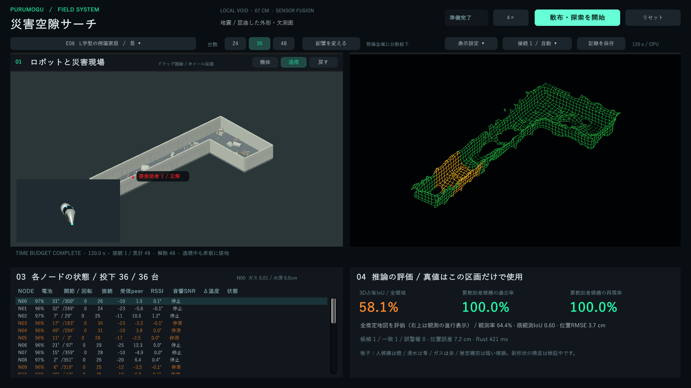
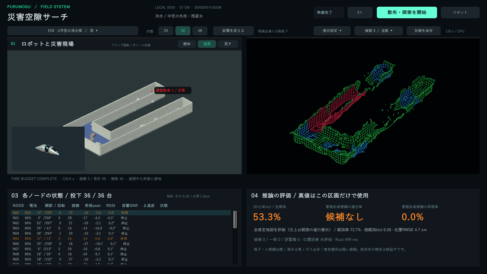
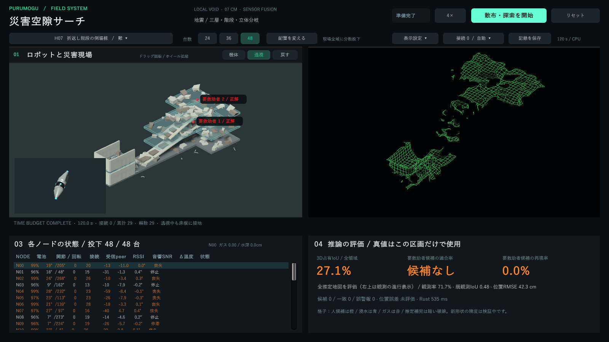

# 多形状・多層マッピング / 開発版3.4

## 変更した機能

右上の格子表示を維持し、周囲の観測から欠測を補完する。観測した格子は実線、推定を使った格子は暗い破線とする。人候補は橙、浸水反応は青、ガス反応は赤。候補の範囲が重なるところは格子の区間を分けて色を残す。文字、球、波紋、判断カードを右上へ戻す変更ではない。

色を付ける位置はRustの人候補・環境反応から取り、シミュレーターが持つ人の正解位置や水・ガスの正解位置は使わない。上下階への誤着色を抑えるため、高さの差も判定する。未検出なら正解位置に近くても着色しない。色の説明は右下に置く。

## 推論による補完

従来の15種類の形状テンプレートへの当てはめを、新しいプロファイルでは使わない。距離と姿勢から得られる占有証拠に、局所平面の補完を加える。

- 両方向に実観測の支持がある小さな欠測を対象にする。
- 同じ高さの面に加え、セル境界で高さがずれた面・緩い傾斜面も周囲の観測点へ平面を当てはめて補う。
- 確かな観測のある空洞や開口を埋めない。
- 推定したセルを次の推定の根拠にして、未観測全体へ広げない。
- 表示の穴をふさぐだけではなく、Rustが補完した占有値とその由来を返す。表示器はそれを破線の格子にする。

支持を探す範囲は最大3セル、15cm。広い未観測領域、根拠のない床や壁、実観測と矛盾する部分は穴として残る。平面の仮定が誤れば補完も誤るため、線の違いを残している。

## 追加した15エリア

既存E01〜H05の15シーンは保存し、新しいE06〜H10を加えた。合計30シーンで、易・中・難は各10。アプリは新しいL字エリアから開き、シーン一覧はスクロールできる。

|難易度|ID|構造|
|---|---|---|
|易|E06|L字の倒壊家屋|
|易|E07|T字交差の崩落通路|
|易|E08|Y字分岐の暗渠|
|易|E09|U字の浸水棟|
|易|E10|中庭のある無人倉庫|
|中|M06|二階建て連絡回廊|
|中|M07|二層の十字吹き抜け|
|中|M08|二層の環状分岐暗渠|
|中|M09|段違いの流木通路|
|中|M10|二層の無人設備室|
|難|H06|三階吹き抜けの崩壊棟|
|難|H07|三層の折返し階段|
|難|H08|三層の斜面段丘・分岐|
|難|H09|三層の浸水した立体迷路|
|難|H10|中庭と連絡橋の三層設備棟|

外形に沿う床と壁を作り、全体を囲む長方形の土台は新シーンで使わない。上階の床、開口、斜路、階段、瓦礫は実際の衝突形状を持つ。上階の床を透過表示しても衝突は残す。上面から散布したノードが、開口やずれた床を通じて異なる階へ着地する。

散布範囲は既知の建物外周に沿う投入範囲として用いる。内部の障害物や人の位置を使って投入先を選ばず、推論サーバーへ外形・階数・シーンIDを送らない。要救助者位置は階も含めて独立した乱数で変わる。

## 複数階の推論

ノードごとの推定高さに加え、下側の占有証拠から床支持を確認し、観測された自由空間を3Dでつなぐ。段差と斜路の高さ変化を経路へ含める。上下で平面座標が同じでも、間をつなぐ観測経路がなければ直接移動する指示を出さない。空中の自由セルだけを移動可能な床と扱わない。

人候補の探索高さを上階まで拡張し、別階にいる無関係な観測者が増えただけで局所的な音反応のスコアが薄まらないようにした。確認担当の総数は制限し、残りは地図探索を続ける。

## 学習の範囲と検証結果

`models/swarm-v34-local/model.json`は既存の音響・距離補正係数を引き継ぎ、形状テンプレートを外したプロファイル。新しい15形状についてニューラルモデルを再学習して95%を達成したモデルではない。追加した補完と経路推定は、観測に基づく幾何推論である。旧モデルの精度はこの版へ流用しない。

Rustのテストは、平面・傾斜面の欠測補完、観測された開口の保護、階をまたぐ移動の禁止、段差経路、別階の観測者と音反応の独立性を含めて確認した。Unityでは、補完を受け取ると欠けた格子面が増えること、3色の格子が別の階へ漏れないことを確認した。

追加15シーンは、各24台・15秒の物理／センサー／TCP／Rust／描画の接続試験を行った。これは機能確認であり、探索完了や救助成功の受入試験ではない。ノード喪失、占有IoU、候補の一致・誤警報は実測のまま保存している。

- [接続試験の全結果](../reports/rescue/complex-v34-smoke.json)
- [格子・補完・色分けの試験](../reports/rescue/echo-wire-v34-smoke.json)
- [実アプリの長めの試行](../reports/rescue/complex-v34-demo.json)
- [開発環境なしの配布起動試験](../reports/rescue/portable-package-v34.json)

120秒の単一試行では、L字・U字・三層の地図IoUや人候補の成績に差がある。三層ではノードの落下と未検出が残る。記録した値はサンプルごとの結果で、独立した最終評価の平均ではない。新形状を含むIoU・人検出の適合率・再現率すべて95%以上という条件は、現在の版では達成したとしていない。

|120秒の試行|台数|地図IoU|観測率|人候補の一致／正解人数|喪失|
|---|---:|---:|---:|---:|---:|
|E06・L字|36|58.1%|64.4%|1／1|0|
|E09・U字浸水|36|53.3%|72.7%|0／1|0|
|H07・三層|48|27.1%|71.7%|0／2|23|

L字では補完した占有セルが120個、U字は139個、三層は82個となった。補完した数を正解数とは呼ばない。格子の表示機能と、未知形状での探索・検出精度は分けて評価する。

## 実画面

L字と人候補の格子色：

U字と浸水・ガス反応の格子色：

三層構造の部分マッピング：

## 起動

Windows配布ZIPをフォルダーごと展開し、`PurumoguSearch.exe`を開く。同梱Rustサービスとモデルが自動で起動する。Unity・Rustの別途インストールは不要。
