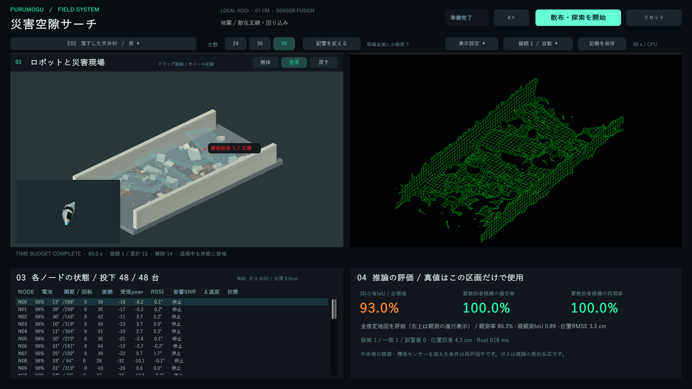

# 緑のワイヤーフレーム表示 / 3.3

右上は黒い背景と細い緑の線だけにした。利用者から追加された反響マップの参考画像と「判断欄・凡例・断面も外す」という指定に合わせ、カード、見出し、凡例、断面、点群、候補マーカー、白い発光、波紋、走査帯を表示しない。ドラッグ回転とホイールによる拡縮は使える。左上のシミュレーション、左下のノード一覧、右下の評価は残す。

## 線の形

独立した立方体の輪郭を並べる方式から、観測した障害物と自由空間の境界をつなぐsurface netへ変更した。占有値が切り替わる位置から表面の頂点を求め、隣の表面と共有する四角格子を組む。三角形の対角線は描かない。表面を少し緩和することで、階段状のセルの角がそのまま線画に出るのを抑える。

線の幅は画面上のピクセルで保ち、奥の線は少し暗くする。裏側の線は深度だけを持つメッシュで隠す。このメッシュは色を描かないため、面の塗りや半透明の重なりは出ない。自動旋回、点滅、発光の脈動はない。

## 観測と推論

描画はRustが返すセンサー由来の占有値と観測回数を使う。2回以上の観測と占有値0.70以上または0.30以下で表示用の状態を作り、弱い揺らぎは保持する。反転には4回以上の観測と0.80以上または0.20以下の証拠を要求する。これらは表示を安定させる条件であり、校正した安全確率ではない。

学習した形状の事前分布だけでは線を作らない。ノード位置、人候補、危険候補、正解地形もこの描画器には使わない。観測が得られた場所から地図が現れ、未観測の穴は残る。音の反射時間を測った能動ソナーの再現ではなく、観測から再構成した空間を参考画像の線画表現で示すもの。

元の推論・評価は5cmセルのまま。表示用の緩和は最大1.75cmに制限し、観測された範囲に留める。これは画面の角を和らげる処理で、位置精度を改善した結果ではない。

## 配布と確認

配布ZIPをすべて展開し、`PurumoguSearch.exe`を開く。同梱のRust推論とモデルを自動起動するため、Unity EditorやRustのインストールは不要。EXEだけを抜き出さず、DLLとデータフォルダーも一緒に配布する。

検証は`reports/rescue/echo-wire-v33-smoke.json`、実画面の確認は`reports/rescue/echo-wire-v33-visual.json`、配布状態での推論と終了処理は`reports/rescue/portable-package-v33.json`に保存する。旧描画器はソースに保持しているが、アプリの右上は`RescueEchoWireMap`だけを使う。

凡例と候補表示を外したため、右上の線画単独では人候補や危険候補の位置、未観測と空洞の違いを判断できない。今回の表示変更は検出精度や本番の救助判断の検証とは別である。
