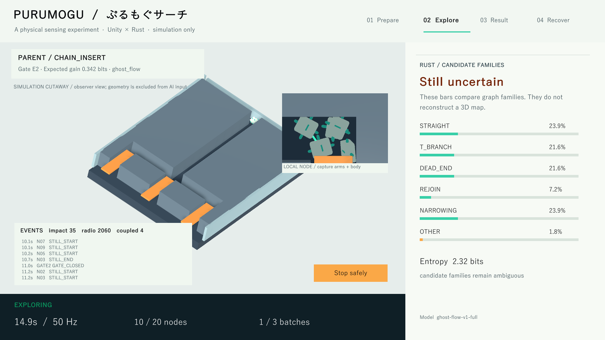

> 初版Phase 1（コミット d1d101e）の記録です。現在の15シーン版は[メインガイド](../README.md)を参照してください。初版の画面と実験を再現する場合は、このコミットを使用します。

# ぷるもぐサーチ / Purumogu Search

小さなノード群を未知の通路へ投入し、衝撃・静止らしさ・無線受信の履歴から、空間構造の候補を絞るUnity × Rustのシミュレーションです。Rustが次の入口と隊形を選び、その命令でUnityのゲートと子ノードが動きます。



**[動作動画](../media/purumogu-demo.mp4) · [説明PDF](../reports/Purumogu_Search_Report.pdf) · [比較結果](../reports/comparison/metrics.json) · [設計と限界](architecture.md)**

実装範囲は設計書v1.1のPhase 1。5形状、20個の利用枠、5個×3バッチ、親ステーション、CLUSTER / CHAIN_INSERT、Rustの学習・ベイズ推論・期待情報利得制御、4画面、比較・障害試験・リプレイを含みます。3D形状の完全復元や実災害での救助能力を示すものではありません。

## 測れたこと

未使用の50マップをセンサーシード2通りで実行。各方式100エピソード、同じ15個・27秒のシミュレーション予算です。

| 方式 | 全試行のTop-1正解率 | 保留率 | 保留しなかった試行の正解率 |
|---|---:|---:|---:|
| GHOST-FLOW | 61% | 79% | 21/21 |
| 固定入口順・CLUSTER | 60% | 70% | 27/30 |
| ランダム入口・隊形 | 46% | 76% | 15/24 |
| 固定入口順・受動流動 | 39% | 95% | 5/5 |

Top-1正解率は、保留した試行も含む最上位候補の一致率です。21/21だけを「精度100%」として扱いません。GHOST-FLOWと固定方式の差は+1ポイント、マップ単位のペア・ブートストラップ95%区間は **-12〜+15ポイント**。固定方式を上回ったとは言えません。ランダムとの差は+15ポイント（同区間+3〜+27）でしたが、この生成器と少数テンプレートの範囲の結果です。

**最大の弱点は未知形状の棄却です。** 別の結合パターンの2マップ×4欠損条件では、8試行中2試行しか保留できず、6試行で誤った断定が残りました。OTHERスコアを信頼できる未知検出確率とは表示しません。数値と失敗例は[評価](../reports/analysis.json)に残しています。

## 環境

- Windows x64、Unity **6000.4.1f1**。インストール済み版を固定して使用しています。LTSとは表記しません。
- Rust **1.94.1**、MSVC C++ビルドツール。`rust-toolchain.toml`と`Cargo.lock`で固定。
- 学習・推論はCPUで実行。クラウドAI/APIキーは不要。
- Python 3はTCP結合試験用。PDF・図・動画を再作成するときだけ`scripts/requirements-media.txt`が必要。
- Unityライセンスは各利用者の有効なライセンスが必要です。UnityライブラリやEditor本体は同梱しません。

## 今日から試す3つの操作

すべてリポジトリのルートで実行します。初回は`rustup toolchain install 1.94.1`を実行してください。

### 1. 画面で探索する

```powershell
.\scripts\Unity-Task.ps1 init
.\scripts\Start-Demo.ps1
```

Rustが先に127.0.0.1:47110で待ち受け、Unityが接続します。ビルド済みプレイヤーがなければEditorが開くので`Assets/Scenes/Main.unity`を開き、Playを押してください。

Prepareで形状と方式を選びStart。Exploreでゲート、Parentの隊形、イベントと候補分布を確認。3バッチ後にResultへ移り、Export logで保存、Go to recovery → Recover and resetで清掃します。Export先はUnityの`persistentDataPath/runs`。通信断・不正応答・タイムアウトでは新規投入と推力を止め、SAFE STOPを表示します。

Windows実行版を自分で作る場合は`.\scripts\Unity-Task.ps1 build`。その後はStart-Demoが`build/PurumoguSearch.exe`を開きます。終了後はStart-Demoが表示したRust PIDを停止してください。実験前に以前のサーバーを閉じてください。

### 2. 同条件で比較する

```powershell
.\scripts\Run-Experiments.ps1
.\scripts\Run-Experiments.ps1 -Faults -Port 47112
```

通常比較は50マップ×2センサーシード×4方式。欠損試験は0/10/20/40%と学習外の結合パターンを使います。生ログは`datasets/generated/v1`、集計は`reports/comparison`、`reports/fault`、`reports/ood`。`python scripts/analyze_results.py`で図とペア比較を更新できます。

全データと別バージョンのモデルを生成する場合は`.\scripts\Run-Experiments.ps1 -Collect`。TRAIN 50 / VALID 15 / 初期TEST 25マップを収集し、比較用TESTは50マップに拡張します。設計書の推奨70/15/15とは異なります。[データ分割の理由](../datasets/README.md)と[チェックサム](../datasets/manifest.json)を参照してください。

### 3. Unityなしで判断を再生する

```powershell
cargo run --manifest-path rust/Cargo.toml --release --locked -p ghost_flow_server -- replay --model models/m-v1/model.json --events datasets/sample.jsonl
```

実測イベントから同じ3バッチの候補分布と行動を再計算します。モデルと入力が同じ場合の推論再生を検証しています。PhysXをもう一度動かしたときのビット単位の一致は保証しません。

## 検証

```powershell
cargo test --manifest-path rust/Cargo.toml --workspace --locked
cargo clippy --manifest-path rust/Cargo.toml --workspace --all-targets --locked -- -D warnings
cargo build --manifest-path rust/Cargo.toml --release --locked
python tests/test_contract.py
.\scripts\Unity-Task.ps1 smoke
```

Rustは確率の正規化、無情報観測、EIG、空イベント、ID置換・順序不変性、スキーマ拒否、ACK待ち、重複バッチを検証。TCP結合試験は実サーバーに不正フィールド・版・未来時刻・巨大行を送り、切断後も待受けが生きることを確認します。Unity smokeは5形状で投入数、重力移動、衝撃・無線イベントを確認します。GitHub ActionsはWindowsとLinuxでRustと実測リプレイを実行します。UnityのCIビルド用ライセンスは公開していません。

## 構成と使いどころ

| 場所 | 内容 |
|---|---|
| `unity/` | 物理、自己結合型ノード、局所モーター、センサー、4画面、TCPブリッジ |
| `rust/crates/` | protocol → event_core → graph → likelihood → inference → planner。evaluationはオフライン専用 |
| `rust/apps/ghost_flow_server/` | train / serve / evaluate / replay |
| `models/m-v1/` | 学習済み固定モデル、特徴、分割、温度、SHA256SUMS |
| `datasets/` | 真値を含まない実測サンプルと生成手順 |
| `reports/` | 全試行CSV/JSON、保留・誤り、95%区間、説明PDF |
| `media/` | 実行画面の動画、ナレーション、BGM、出典 |

**メリット:** 低コストなCPU推論で行動まで閉じ、イベントと判断を検査できる。**デメリット:** 5つの形状族と簡略センサーへの依存が大きく、未知形状に強くない。次の代替案は、履歴条件付きの予測器、(構造・摩擦・遮蔽)の粒子フィルタ、および独立したRust分類器との比較です。[要件対応表](requirements.md)に今回の簡略化と将来項目を分けて記載しています。

コードはMIT。音声・BGMはMITの対象外です。動画の音声は**音読さん**、音楽は**Suno AI**を使用しています。[音声・音楽の出典と条件](../media/CREDITS.md)を参照してください。YouTube/OmniCampusへのアップロードはこのプロジェクト作成作業の範囲に含めていません。
