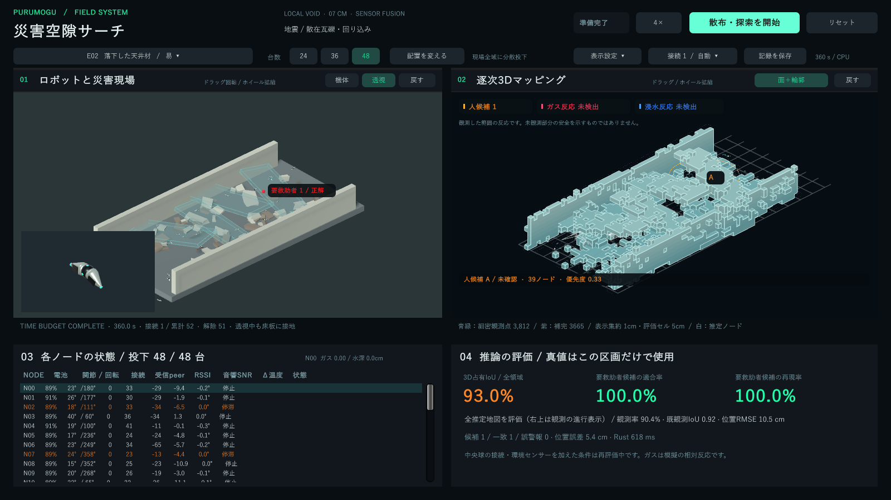

# 配布版3.2

Windows x64用のZIPをすべて展開し、`PurumoguSearch.exe`を起動する。
Unity Hub、Unity Editor、Rust、Python、PowerShellの別途インストールは不要。
EXEだけでなく、DLL、`PurumoguSearch_Data`、`MonoBleedingEdge`も一緒に配布する。

E02・48台・360秒の開発用単一実行。観測率90.43%、候補から30cm以内の推定ノードは3台。これは受入評価全体の精度を代表する値ではない。この実行の喪失は4台で、位置誤差や理想化した移動の限界も残る。

## 同梱の推論

`StreamingAssets/inference`へRustサービスとモデルを同梱する。プレイヤーが自分用の空きループバックポートを選び、非表示の子プロセスを起動する。通常終了時はその子だけを停止し、強制終了時はWindowsのkill-on-close jobで子を閉じる。複数のプレイヤーは別のポートと子プロセスを使う。

`--port`を明示した既存の収集・評価スクリプトは外部サービスへ接続する。アプリ自身が起動していないプロセスを終了しない。ファイル不足や起動失敗は画面に表示する。

開発者は`cargo build --manifest-path rust/Cargo.toml --release --locked -p rescue_server`後にUnityプレイヤーをビルドする。ビルド前処理がサービスと開発モデルをコピーする。配布は`scripts/Package-Demo.ps1`でZIP化する。

## 探索と確認の役割

旧制御では到達可能な地図探索先が見つからないと音響確認へ回り、確認担当が増え続けた。現行の散布条件では、確認担当の総数を24台で3、36台で5、48台で6台までに制限する。音響の一つの山に向かう担当は最大3台とし、確認待機も総数の上限に含める。他のノードは未観測境界と再観測対象を探す。

床板への着地で高さが変わるため、単一のy=0断面でなく、各ノードの推定高さに近い観測から経路を組み立てる。到達可能な観測済み自由セルの中で、情報不足、再訪間隔、ほかのノードとの間隔を評価する。正解地形や人の正解位置は使わない。

## 面と輪郭

右上は「面＋輪郭」を標準とし、「点群」へ切り替えられる。2回以上の距離観測に支持された5cmセルの外側の面を描き、内部の共有面は除く。陰影と外周・折れ目の輪郭で壁や瓦礫の厚さを読みやすくする。細密距離点群は補助として重ねる。

学習補完は薄い紫の点で区別し、未観測の補完に不透明な面を与えない。これは観測セルの面表示であり、1cm精度の滑らかな実物メッシュを復元したという意味ではない。占有の評価値・候補判定を、表示切替で変更しない。

## 赤い球とランダム位置

左上の赤い球は要救助者の正解位置で、遮蔽物越しにも見える。衝突判定を持たず、距離センサーを遮らない。表示設定でON/OFFにできる。右上の未確認候補は黄橙のままにし、正解位置を渡さない。

通常起動時は要救助者用の乱数を変える。「配置を変える」は散布位置と要救助者位置の両方を変更し、単なるリセットや台数切替は同じ正解位置を保つ。評価用の既存`--seed`は固定配置を再現でき、別指定の`--source-seed`で地形を変えずに人の位置だけを変えられる。無人のE05とM05では赤い球は表示されない。

## 検証

- Rust：48台全員に音響・温度反応があっても確認6台・地図探索42台。探索先不足を理由に残りを音響確認へ回さない。
- Unity：同梱サービス2つの起動・異なるポート・片方の終了時の独立性を確認。
- Unity：単一占有セル12三角形、隣接2セル20三角形。未観測の形状事前分布を面として表示しない。
- Unity：人がいる13シーンで独立した乱数による正解位置の変更と、Colliderのない可視赤球を確認。

探索制御の変更により、旧12台・現行3.1の集計精度を3.2の実績には流用しない。配布モデルは開発用であり、実機の捜索性能は未検証。
