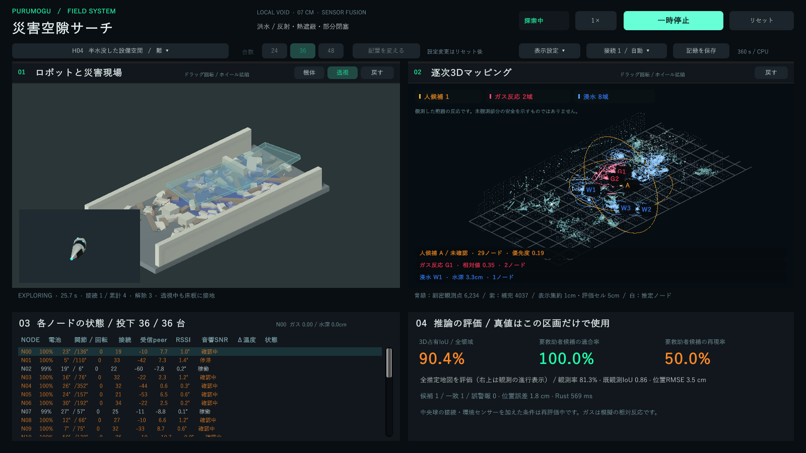

# 現行の操作・接続・危険表示（3.1）

H04・36台の動作確認例。途中時点の単一実行であり、95%達成や最終評価の代表値ではない。

## 見分けるための色と形

地形は控えめな青緑とし、重要な色を人と危険反応に割り当てる。参考画像の点群表現を採用し、高さは地形の明るさで補助的に表す。危険の種類を高さの虹色に混ぜない。

| 表示 | 色・形 | 意味 |
|---|---|---|
| 人候補 A–C | 黄橙・立体の範囲リング・日本語ラベル | 音響などから推定した未確認候補。救助者と確定した表示ではない |
| ガス G1–G8 | 赤紫・三角形・範囲リング | ノードが観測した相対ガス反応の領域。確定した漏洩源や濃度ではない |
| 浸水 W1–W8 | 青・波形・範囲リング | 接触式の模擬水深観測。水深はcmで表示 |
| 観測地形 | 青緑の点群 | 距離観測の端点を1cm格子で集約した細密表示 |
| 学習による補完 | 薄い紫 | 観測近傍の推定。観測済みセルへ加算しない |
| 推定ノード | 白い点・選択ノードの細い軌跡 | 誤差を含む推定位置。真の位置を表示していない |

色のほか、記号・ID・ラベルを併用する。上部の表示件数、地図上の領域、下部の反応詳細を対応させる。人候補、ガス、浸水の順で情報を並べる。種類ごとに最大8領域を保持し、多数の浸水パッチによってガス表示が消えないようにする。

細密レイヤーは距離観測の端点を誤差付き推定位置で変換し、1cm格子で重み付き集約する。2回以上の観測を必要とし、近傍で最大3mmに制限した平滑化、ソフトな点描画、更新時のフェードを使う。観測済み5cmセルの輪郭を薄く重ね、細密点が届いていない観測済み部分も識別できるようにする。集約間隔1cmは測定精度ではなく、観測ノイズと姿勢誤差は残る。

表示は最大24,000点、内部の集約は最大120,000点に制限する。30秒を超えて再観測されない点は表示から外す。正解地形を参照せず、未観測領域を細密点で埋めない。判定・学習・95%の評価には従来どおり5cm占有セルを使う。細密表示の有無で、その地図・人候補・探索指令が変わらないことを試験する。

## 両方の3D画面を操作する

左上と右上はそれぞれ独立して、左ドラッグまたはホイール押し込みドラッグで回転し、ホイール回転で拡大・縮小する。上下反転を制限し、倍率は0.38–2.5倍の画角範囲に制限する。カメラは滑らかに動き、一時停止中も操作できる。各画面の「戻す」は角度と倍率を初期化し、「表示設定」から両画面を一緒に戻せる。ノード一覧上のホイール操作は一覧だけをスクロールする。

探索開始・一時停止を主操作として大きく配置し、台数は24・36・48の選択式に変更した。機体拡大と透視は物理画面の見出しへ置き、真値表示・接続の操作はドロップダウンへまとめた。

## 球体にも接続面を設ける

前後の円錐先端2面に、中央球の左右・上下4面を追加し、合計6面とする。円錐と干渉する前後の球面には接続面を設けない。

先端同士、球同士、先端と球を、対応するRigidbodyにConfigurableJointを作って接続する。球を含む場合の捕捉距離は5mm、先端同士は9mm。接続面の向きと点速度を確認し、瓦礫を挟む接続、同じペアの多重接続、閉ループを防ぐ。解除・破断後は使用中フラグを解放し、再接続できる。

## 危険反応も観測から作る

ガスと水深の模擬観測を追加した。Unityは相対ガス反応と水深だけを送信する。漏洩源の座標、水面の正解領域、危険ラベルをRustへ渡さない。Rustは既存の推定ノード位置に観測を重ね、近傍の反応を集約する。

- ガス：E05・M05・H04に模擬発生源を設ける。空間的な減衰、遮蔽、一次遅れ、独立した観測ノイズを加える。値は0–1の相対反応で、ppmや爆発下限界の百分率には校正していない。
- 水深：浸水条件の局所水面とノード下面の接触から深さを観測し、ノイズを加える。浮力・流体解析は行わない。
- 表示：ガス相対値0.25、水深4mmを表示用の仮閾値とする。2回以上の観測を必要とし、単独・複数ノードの観測数を表示する。30秒を超えた古い反応は表示から外す。表示半径は探索用で、校正済みの信頼区間ではない。

「未観測」「反応未検出」を区別し、安全確認済みとは表示しない。これらの仮閾値は実災害の警報基準ではない。実際のガスセンサーは対象ガスや干渉ガス、環境条件に依存する（[Figaro TGS2611資料](https://www.figarosensor.com/product/docs/Long2611CE%20Layout%20%281117%29.pdf)）。本シミュレーションは同センサーの実装・性能を再現したものではない。

## 今日から試す3例

1. `./scripts/Start-Demo.ps1 -Scene 0 -Nodes 24`：E01で観測開始後、両画面の回転・ズームを比べ、人候補の黄橙表示を確認する。
2. `./scripts/Start-Demo.ps1 -Scene 4 -Nodes 36`：E05は無人のガス反応条件。ガス反応を人候補と取り違えていないか確認する。
3. `./scripts/Start-Demo.ps1 -Scene 13 -Nodes 48`：H04でガスと浸水の色・記号を比べ、一時停止して水深と観測数を読む。

## 検証と未完了の範囲

専用試験は3種類の接続・解除・多重接続防止・瓦礫越しの接続拒否を確認する。15シーン×3台数の物理試験は別途実施する。未観測地形を表示しないこと、近傍だけを補完すること、ガス・水深の異常値を更新前に拒否することも検査する。

利点は、色の意味を種類ごとに固定し、観測と推定、危険反応と人候補を比較できること。弱点は、危険の種類や濃度を実機で同定した結果ではなく、気流・流体・センサーの消費電力を再現していないこと。実機での校正と独立した災害データでの評価が必要である。

旧3.0収集はTRAIN84/225・VALID86/90の途中で停止していた。途中記録とソースを保全し、合格実績には扱わない。中央球接続と環境観測を加えた条件は[3.1事前登録](../reports/rescue/swarm-v31/protocol-design.json)で別に評価する。従来からの95%条件は地図IoUと人候補の適合率・再現率であり、危険反応の表示性能を95%と認定したものではない。

## 使用済みのナレーション原稿

[災害シミュレーション版](../media/ナレーション原稿_災害シミュレーション_使用版.txt)は、音読さんで生成した`rescue-narration-v2.mp3`の元原稿と同一のテキスト。今回の追加機能を後から混ぜて、既に読み上げた原稿として扱っていない。[初期デモ版](../media/ナレーション原稿_初期デモ_使用版.txt)も別ファイルで保存した。
