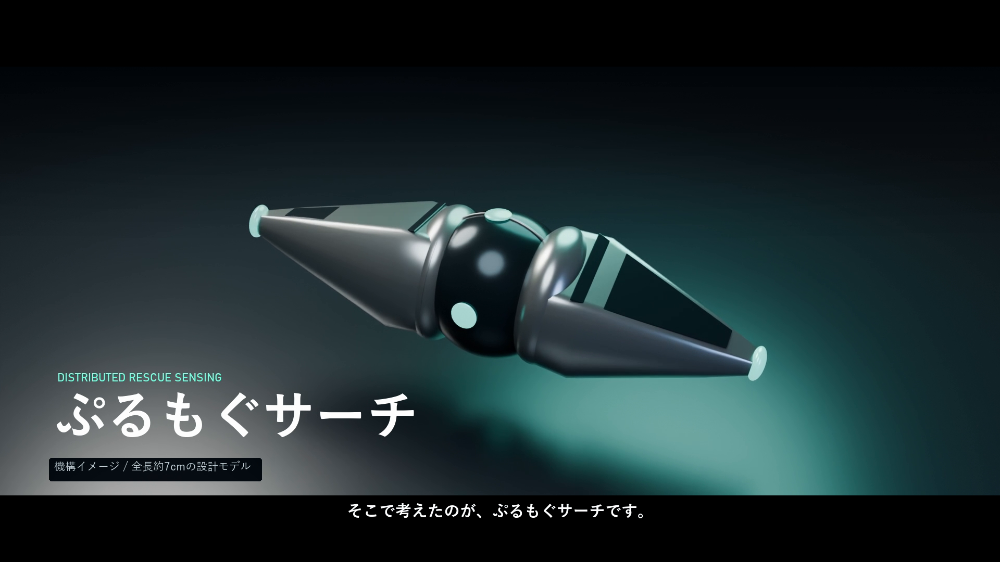

# 映像の構成

2026-10-28のコンセプト映像は、指定原稿による**2分29.5秒・1920×1080・30fps**。ローカルの`purumogu-concept-film.mp4`と`Purumogu_Concept_Film_20261028.drp`に保存した。完成MP4は約140MBのためGitには含めず、コード・原稿・編集計画・検査結果を公開する。

声は音読さん / Gray、専用BGMはSuno AI / *Purumogu — Signals in the Void*。編集・文字の動き・合成・音声の正規化・ミックス・最終書き出しはDaVinci Resolve Studio 21.1で実施した。金属質の機構イメージはBlenderで制作し、実際のUnity/Rust収録とは画面上で区別した。

[指定原稿](ナレーション原稿_コンセプト映像_20261028.txt)、[編集計画](concept-film-edit-plan.json)、[制作手順と出典](concept_film_sources/README.md)、[完成MP4の検査結果](../reports/concept-film-qc.json)。全4,485フレームをデコードし、主要18場面を目視確認した。総合音量は−17.3 LUFS、真のピークは−3.7 dBFS。これは映像・音声の検査であり、救助推定の精度認定ではない。

使用済みの原稿は、[災害シミュレーション版](ナレーション原稿_災害シミュレーション_使用版.txt)と[初期デモ版](ナレーション原稿_初期デモ_使用版.txt)をUTF-8テキストで保存した。前者は`rescue-narration-v2.txt`、後者は`narration.txt`と同じ内容で、実際に生成した読み上げの原稿である。現行アプリの追加機能を反映した改訂原稿とは区別する。

`purumogu-demo.mp4` は115秒、1920×1080、30fps。DaVinci Resolve Studio 21.1で編集・音声調整・書き出しを行った。声は音読さん、BGMはSuno AI。出典と利用条件は[CREDITS.md](CREDITS.md)。

| 時間 | 内容 |
|---|---|
| 0:00–0:10 | 目的 |
| 0:10–0:35 | ゲート、重力、接触、無線観測 |
| 0:35–0:55 | Rustの候補分布と次の投入 |
| 0:55–1:10 | 一時連結の拡大。別実行であることを明記 |
| 1:10–1:30 | 同じ予算での比較と95%区間 |
| 1:30–1:45 | 未知形状の誤断定と実装の限界 |
| 1:45–1:55 | 音声・音楽・編集・公開先 |

`resolve-edit-plan.json` にフレーム単位の配置と音量を保存した。`resolve_sources/` は未編集のアプリ収録クリップと章カード。元のPNG連番は容量が大きいためGitの対象外だが、`scripts/Record-Demo.ps1` と `scripts/prepare_resolve_media.py` で再収録・素材化できる。

ローカル成果物の `Purumogu_Search_Film.drp` はResolveで再編集できる。メディアがオフラインになった場合は、メディアプールの「選択したクリップを再リンク」で `resolve_sources/` とこのディレクトリ内の音声を指定する。DRP内の個人フォルダー名を公開しないため、Gitには含めていない。
